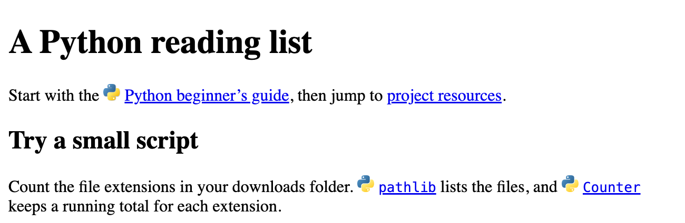

# astro-link-favicons

Display favicons beside external links in Astro Markdown pages.



## Usage

Install the package and the Markdown processor in your Astro project.

```sh
pnpm add astro-link-favicons @astrojs/markdown-remark
```

Register the astro integration and rehype plugin in `astro.config.ts`. Set `site` to
your site's URL to skip absolute links to your own hostname.

```ts
import {unified} from "@astrojs/markdown-remark"
import favicons from "astro-link-favicons"
import {defineConfig} from "astro/config"

export default defineConfig({
  site: "https://example.com",
  integrations: [favicons.integration],
  markdown: {
    processor: unified({rehypePlugins: [favicons.rehypePlugin]}),
  },
})
```

Add this rule to your global stylesheet to display the icon before the link text.

```css
a[style*="--favicon:"]::before {
  content: "";
  display: inline-block;
  width: 1em;
  height: 1em;
  margin-inline-end: 0.25em;
  background: var(--favicon) center / contain no-repeat;
}
```

Write links as usual in Markdown.

```md
Read the [Python beginner's guide](https://www.python.org/about/gettingstarted/).
```

See the [example site](./example) for a working configuration and Markdown page.

## Look up a favicon

Pass a link to `getFaviconUrl` in Astro frontmatter as a string or `URL`.
Use the result as an image source. Local links and links without an available
favicon return `null`.

```astro
---
import {getFaviconUrl} from "astro-link-favicons"

const href = "https://www.python.org/"
const icon = await getFaviconUrl(href)
---
<a href={href}>{icon && } Python</a>
```

## Refresh or remove cached favicons

To refresh one site's icon or retry a failed download, remove that site's cache
folder, then restart the dev server or rebuild. The following commands assume
Astro's default cache location and run from your project root.

```sh
rm -rf node_modules/.astro/astro-link-favicons/www.python.org
```

To refresh all icons and discard unused ones, stop the dev server, clear the
favicon cache, and run a clean build.

```sh
rm -rf node_modules/.astro/astro-link-favicons
pnpm exec astro build
```
